# 🌌 Skywatch

> **Offline-first, voice-first stargazing PWA for the DEV Hacktoberfest "Touch Grass" challenge.**  
> *The point of the project: open-weight AI that gets people OUTSIDE and keeps the screen the shortest part of the experience.*

---

## 🧭 Product in One Line
**Plan your night** ➔ **Find the best dark spot** ➔ **Get spoken cues for when to look** ➔ **Ask about what you captured** ➔ **Get a Night Card that shows how little screen time you used.**

---

## 🏗️ Architecture Diagram

```mermaid
flowchart TD
    subgraph UI ["Client PWA (Mobile-First, Vite + React + Tailwind)"]
        PV[1. Plan View]
        SV[2. Scout View]
        WV[3. Watch Session\nRed-Light OLED Mode]
        CV[4. Capture & Ask]
        NC[5. Night Card\nHeadline Screen-Seconds]
        CM[6. Community Circles]
        ST[7. Streaks & Totals]
    end

    subgraph Planner ["Open-Weight Agentic Planner"]
        MC[Config: modelConfig.json]
        MODES[Config: modes.json\nBeginner, Family, Short, Poor Weather]
        LLM["Gemma 3 (Ollama localhost:11434)\nDefault: gemma3:4b"]
        DET[Deterministic Astronomy Fallback]
        ZOD[Zod Schema Validation]
    end

    subgraph Tools ["Offline Computation Tools (Zero Hallucinations)"]
        T_SKY["get_sky_events()"]
        T_WTH["get_weather()"]
        T_SCOUT["score_locations()"]
        T_CTX["get_user_context()"]
    end

    subgraph Engines ["Offline Astronomy & Physics Engines"]
        ASTRO["astronomy-engine\n(Planets, Moon Phase, Alt/Az, Rise/Set)"]
        SAT["satellite.js SGP4 Propagator\n(ISS Passes from Cached TLE)"]
        METEOR["Meteor Showers Catalog\n(Perseids, Geminids, Orionids)"]
        SCOUT_ENG["Dark Sky Scout Engine\n(Bortle Grid + Moon Wash + Clouds)"]
        WEATHER["Open-Meteo Cache\n(Hourly Clouds & Visibility)"]
    end

    subgraph DeviceSensors ["On-Device Hardware & Sensors"]
        COMPASS[DeviceOrientation Compass Heading]
        SCREEN_TIMER[visibilitychange Foreground Timer]
        SPEECH[Web Speech API: TTS & Voice STT]
        IDB[(IndexedDB: idb\nCards, Plans, Offline Caches)]
    end

    PV --> LLM
    LLM --> T_SKY & T_WTH & T_SCOUT & T_CTX
    T_SKY --> ASTRO & SAT & METEOR
    T_WTH --> WEATHER
    T_SCOUT --> SCOUT_ENG
    LLM -.->|Fails / Offline| DET
    DET --> ZOD
    LLM --> ZOD
    ZOD --> PV

    PV -->|Launch Session| WV
    WV --> COMPASS & SCREEN_TIMER & SPEECH
    WV -->|Session End| NC
    NC --> IDB
    IDB --> ST
```



---

## 🚀 Quickstart & Setup

### 1. Prerequisites
- **Node.js 18+** (Node v20 or v24 recommended)
- **Ollama** installed locally ([ollama.com](https://ollama.com))

### 2. Pull the Open-Weight Model
Pull the default Gemma model:
```bash
ollama pull gemma3:4b
```
*(Optional alternate models: `ollama pull gemma:2b` or `ollama pull llama3.2:3b`)*

### 3. Clone, Install & Start Development Server
```bash
# Clone repository
git clone https://github.com/Tswetabh/sky-watch.git
cd sky-watch

# Install dependencies
npm install

# Start Vite PWA development server
npm run dev
```
Open `http://localhost:5173` in your browser. Install as a PWA on mobile via "Add to Home Screen".

### 4. Build for Production
```bash
npm run build
```

---

## 🧪 Proof Requirements

### 1. ✈️ Airplane-Mode Proof (Zero Network Leaks)
Verify that **Plan**, **Scout**, **Watch**, and **Night Card** run 100% offline with zero outbound network calls:
```bash
npm run verify-offline
```
**Verification Checklist:**
- [x] **PLAN:** Generates ephemeris targets, Moon illumination, and leave-by time without network.
- [x] **SCOUT:** Ranks nearby spots using bundled Bortle grid and moon altitude calculation.
- [x] **WATCH:** Computes relative compass direction (`slightly to your right`) and records foreground screen-seconds.
- [x] **NIGHT CARD:** Persists Night Card to IndexedDB and computes consecutive night streaks.
- [x] **ZERO LEAKS:** Verified that 0 network requests left the device.

In the app, toggle the **"Simulate Airplane"** pill in the top header at any time to verify offline execution in the browser.

### 2. 🔀 Model-Swap Proof
Switch the planner model from a single config/CLI command without code changes:
```bash
# Swap to gemma:2b
npm run swap-model -- gemma:2b

# Swap back to gemma3:4b
npm run swap-model -- gemma3:4b
```

Run the side-by-side benchmark evaluating 3 prompts across two models:
```bash
npm run compare-models -- gemma3:4b gemma:2b
```
Outputs latency, target counts, Zod validation pass/fail, and quality metrics side-by-side in a formatted table.

---

## 🌟 The 7 Features (Built in Order)

| # | Feature | Details |
|---|---|---|
| **1** | **PLAN** | User enters minutes (15, 20, 30, 45, 60m) and picks a mode (`beginner`, `family`, `short-session`, `poor-weather`). Outputs a timed Sky Plan, best location suggestion, and "leave by" time. |
| **2** | **SCOUT** | **Dark Sky Scout**: Ranks nearby spots from a bundled light-pollution grid (Bortle 1–9) combined with cloud cover and Moon interference. Scores each spot 0–100 with a crisp one-line reason. Fully cached. |
| **3** | **WATCH** | **Ultra-Dark Red-Light Mode** (`#050202`). One big thumb-friendly tap target. Stays quiet and speaks only when an event approaches ("*ISS visible in two minutes. Look northwest.*"). Supports voice commands (*"What's that?", "What's next?", "How long?", "Tell me about this."*) with DeviceOrientation relative compass cues (*"slightly to your right"*). |
| **4** | **CAPTURE & ASK** | Upload an outdoor sky photo and ask a question. Grounded against verified astronomical ephemeris calculated for that exact timestamp and coordinate. Honestly states that `gemma3:4b` is text-only without falsely claiming pixel AI vision. |
| **5** | **KEEP** | Session conclusion generates the official **Night Card**. **SCREEN-SECONDS** is the bold headline stat (e.g. *42 seconds on screen during 45 minutes outside*). Logs objects observed, best moment, and next target. |
| **6** | **COMMUNITY** | Minimal nearby stargazing circles. One tap to RSVP. Backed by mock dataset (`communitySessions.json`). Zero algorithmic feeds, zero follows, zero chat. |
| **7** | **STREAKS** | Consecutive-night streak counter and outdoor hours derived directly from stored Night Cards in IndexedDB. Awards milestones for touching grass. |

---

## 🔍 What is Real vs. Mocked

To adhere to scientific integrity:

### 100% Real (Mathematically Computed On-Device)
1. **Planetary Ephemeris:** Exact positions, altitudes, azimuths, and visual magnitudes for Venus, Jupiter, Saturn, Mars, and Mercury computed via `astronomy-engine`.
2. **Lunar Physics:** Moon phase name, illumination fraction, topocentric altitude, and terminator visibility via `astronomy-engine`.
3. **ISS Orbit Propagation:** Real-time SGP4 orbital propagation from NORAD Two-Line Element (TLE) set using `satellite.js`.
4. **Annual Meteor Showers Catalog:** Real radiant bearings, velocities, and ZHRs for Perseids, Geminids, Quadrantids, Orionids, Leonids, Lyrids, and Eta Aquariids.
5. **Foreground Screen-Seconds:** Measured accurately via the browser `visibilitychange` API and foreground interaction ticks.
6. **Dark Sky Physics Scoring:** Multi-factor formula combining Bortle darkness points (0–55), Moon illumination altitude wash (0–20), and atmospheric cloud blockage multiplier.
7. **Offline Storage:** IndexedDB (`idb`) persists Night Cards, weather forecasts, and scout caches.

### Mocked / Approximated (Documented in Code)
1. **Light Pollution Grid:** Pre-compiled reference anchor grid calibrated to the *New World Atlas of Artificial Night Sky Brightness (Falchi et al., 2016)* and IDA Dark Sky Reserves. Limits: Pre-computed anchor points provide offline baseline estimates; cannot dynamically detect hyper-local stadium lights 50 meters away.
2. **Community Circles API:** The community stargazing gatherings in `communitySessions.json` are mock API records demonstrating one-tap RSVP without building unnecessary social networks or chat algorithms.
3. **Offline Weather Fallback:** If offline without a previously cached Open-Meteo forecast, the system falls back to a safe clear-sky model rather than crashing.
4. **Model Computer Vision:** The local Gemma model runs in text-only mode; photo answers are grounded in mathematical ephemeris for that moment rather than simulated image recognition.

---

## 📂 File Tree

```
Sky_watch/
├── package.json
├── tsconfig.json
├── tsconfig.node.json
├── vite.config.ts
├── tailwind.config.js
├── postcss.config.js
├── index.html
├── public/
│   ├── favicon.svg
│   ├── icon-192.png
│   ├── icon-512.png
│   └── manifest.webmanifest
├── src/
│   ├── index.css
│   ├── main.tsx
│   ├── App.tsx
│   ├── config/
│   │   ├── env.ts
│   │   ├── modelConfig.json
│   │   └── modes.json
│   ├── data/
│   │   ├── cachedTle.json
│   │   ├── communitySessions.json
│   │   ├── lightPollutionGrid.json
│   │   └── meteorShowers.json
│   ├── types/
│   │   ├── planner.ts
│   │   ├── scout.ts
│   │   ├── session.ts
│   │   └── speech.ts
│   ├── lib/
│   │   ├── astronomy.ts
│   │   ├── captureAsk.ts
│   │   ├── compass.ts
│   │   ├── db.ts
│   │   ├── networkGuard.ts
│   │   ├── satellite.ts
│   │   ├── scout.ts
│   │   ├── screenTimer.ts
│   │   ├── weather.ts
│   │   ├── agent/
│   │   │   ├── deterministicPlanner.ts
│   │   │   ├── gemmaClient.ts
│   │   │   ├── schemas.ts
│   │   │   └── tools.ts
│   │   └── speech/
│   │       └── browserSpeech.ts
│   ├── components/
│   │   ├── CaptureAskView.tsx
│   │   ├── CommunityView.tsx
│   │   ├── Header.tsx
│   │   ├── Navigation.tsx
│   │   ├── NightCardView.tsx
│   │   ├── OfflineBadge.tsx
│   │   ├── PlanView.tsx
│   │   ├── ScoutView.tsx
│   │   ├── StreaksView.tsx
│   │   └── WatchView.tsx
│   └── tests/
│       ├── offlineNetwork.test.ts
│       ├── planner.test.ts
│       ├── scout.test.ts
│       └── screenTimer.test.ts
├── scripts/
│   ├── airplane-mode-verify.ts
│   ├── compare-models.ts
│   ├── generate-icons.js
│   └── swap-model.js
└── README.md
```

---

## 📜 Unit Tests
Run the comprehensive Vitest test suite:
```bash
npm test
```
Tests cover:
- Dark Sky Scout scoring physics, Moon interference, and cloud penalties
- Zod plan schema validation and deterministic planner fallback
- Foreground screen-seconds accumulation and visibility change pauses
- Offline session network integrity ensuring zero outbound request leaks
